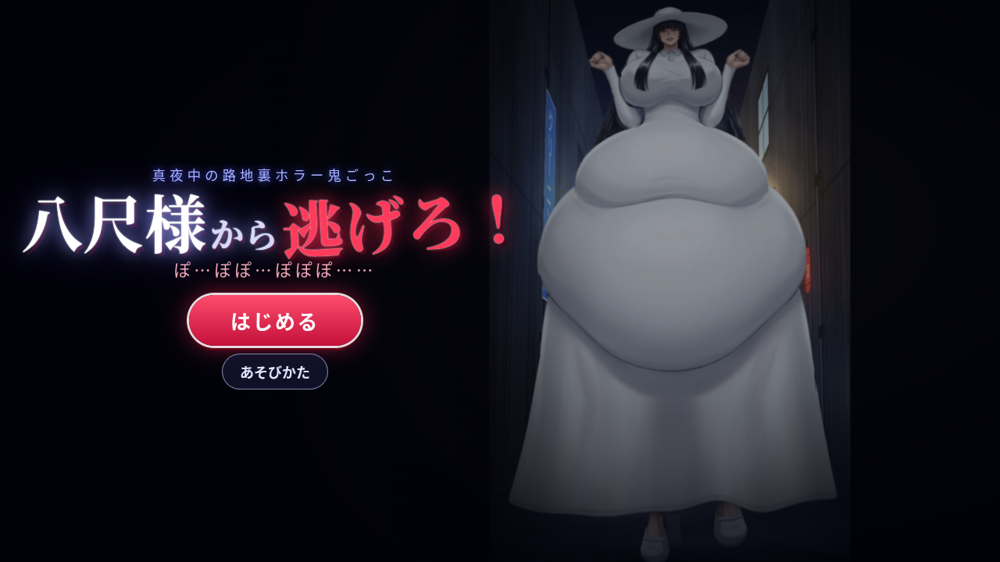

# 八尺様から逃げろ！

真夜中の路地裏で、お腹の大きな八尺様から逃げ回るホラー鬼ごっこゲームです。
ブラウザだけで動きます（インストール・ビルド不要／スマホ・PC対応）。



## あそびかた

| 操作 | スマホ | PC |
|---|---|---|
| 移動 | 画面のどこでもドラッグ（その場にスティックが出ます） | 矢印キー / WASD（マウスのドラッグでもOK） |
| 脱出（捕まったとき） | 画面を連打 | クリック連打 / スペース・Enter・Z 連打 |
| 一時停止 | 右上の ⏸ | Esc / P |

- 八尺様に近づかれると **捕まって（拘束されて）** しまいます。
- 捕まったら **八尺様のお腹を連打！** ゲージが満タンになれば脱出、ゲージが空になるか時間切れでゲームオーバー。
  叩いた場所のお腹がぷるんと揺れます。
- 八尺様は捕まえられない時間が続くと **イライラ** が溜まり、満タンになるたびに **お腹が段階的に巨大化** します（上限なし）。
  大きくなるほど当たり判定も広がり、脱出も難しくなります。
- 「ぽぽぽ！」と身構えて足元に赤い線が出たら **突進** の合図。横に避けましょう。
- スコアは **生き延びた時間**。ベスト記録はブラウザ（localStorage）に保存されます。
- 右上の 🔊 で消音できます（効果音・BGMはすべてWebAudioでその場で合成しています）。

## 遊び方（ファイル）

- **いちばん簡単**：`hachishaku.html` をダブルクリックしてブラウザで開くだけ（画像もプログラムも全部入りの1ファイル）。
- フォルダ版：`index.html` を開いても同じように遊べます。

## GitHub Pages で公開する方法

1. GitHubで新しいリポジトリを作成（例：`hachishaku-game`、Public）。
2. このフォルダの中身（`index.html`・`src/`・`assets/`・`.nojekyll` など）をリポジトリ直下にアップロード
   - ブラウザなら「Add file → Upload files」にフォルダの中身をドラッグ＆ドロップ → Commit
   - コマンドなら：
     ```bash
     cd hachishaku-game
     git init && git add . && git commit -m "八尺様から逃げろ！"
     git branch -M main
     git remote add origin https://github.com/<ユーザー名>/hachishaku-game.git
     git push -u origin main
     ```
3. リポジトリの **Settings → Pages** を開き、Source を「Deploy from a branch」、Branch を `main` / `/ (root)` にして Save。
4. 1〜2分後に `https://<ユーザー名>.github.io/hachishaku-game/` で遊べるようになります。

## ファイル構成

```
index.html          … ゲーム本体（フォルダ版）
hachishaku.html     … 1ファイル完結版（全アセット埋め込み）
src/style.css       … 画面デザイン
src/gl.js           … WebGLメッシュ描画エンジン
src/hachi.js        … 八尺様のリグ（メッシュ変形アニメーション・表情）
src/bg.js           … 夜の路地裏ステージ（プログラムで描画）
src/player.js       … 主人公（ランドセルの子）のスプライト生成
src/audio.js        … 効果音・環境音・「ぽぽぽ」声の合成
src/game.js         … ゲーム進行・操作・カメラ・UI
src/assets.js       … 画像データ（base64埋め込み。file://で開いてもWebGLで使えるようにするため）
assets/             … 切り抜いたレイヤー画像（上半身・お腹・スカート・脚・表情差分・タイトル絵）
tools/              … 画像の切り抜き・レイヤー分け・表情差分づくり・ビルド用スクリプト（Python）
screenshots/        … スクリーンショット
```

## しくみ（技術メモ）

- 元のイラストをAI背景除去（rembg / isnet-anime）で切り抜き、
  **上半身・お腹・スカート・左右の脚・顔** のレイヤーに分割。隠れていた部分（お腹の裏のスカート、脚の付け根など）は補完しています。
- 各レイヤーを細かい三角形メッシュにしてWebGLで描画し、毎フレーム頂点を動かしてアニメーションしています。
  - 歩行：足を交互に持ち上げ、スカートの裾が足に合わせて持ち上がる／体の上下動・腰の揺れ
  - お腹：バネ物理で「遅れて揺れる」フォロースルー、着地のたびの潰れ・伸び、叩いた場所のへこみと波紋
  - 髪・帽子・腕：揺れ、帽子のつば遅れ、拳を振る動き、まばたき、口の開閉（ぽぽぽ）
  - 巨大化：お腹を腰の付け根からなめらかに膨らませ、地面に着いたらお腹が地面で潰れて体ごと持ち上がります
- 表情（にこにこ／ぽぽぽ／イライラ／つかまえた♪／びっくり）は、元の顔をベースに目・口だけを
  描き直した差分画像を用意し、メッシュ変形（まばたき・口パク）と組み合わせてクロスフェードしています。

## 再ビルド

画像やコードを変更したら：

```bash
# 元画像を tools/src.jpg に置いてから
python3 tools/cut.py           # rembg(isnet-anime)で背景除去 → tools/cut_raw.png
python3 tools/make_layers.py   # レイヤー分割
python3 tools/faces.py         # 表情差分
python3 tools/build_assets.py  # src/assets.js を生成
python3 tools/build_single.py  # hachishaku.html と zip を生成
```
