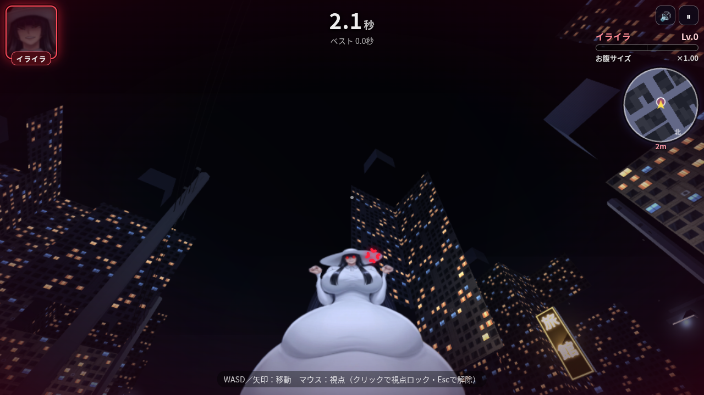

# 八尺様から逃げろ！

真夜中の住宅街・路地裏を歩き回り、お腹の大きな八尺様（身長約3.4m）から逃げ回る **一人称3D** ホラー鬼ごっこゲームです。
ブラウザだけで動きます（インストール・ビルド不要／スマホ・PC対応、WebGL2 対応ブラウザが必要）。




## あそびかた

| 操作 | スマホ | PC |
|---|---|---|
| 移動 | 画面の **左半分** をドラッグ（左スティック） | WASD / 矢印キー |
| 視点（見回す・見上げる） | 画面の **右半分** をドラッグ（右スティック。上に倒すと見上げる） | マウス（画面クリックでマウス固定＝ポインターロック。固定できない環境ではドラッグで視点移動） |
| 脱出（捕まったとき） | 目の前のお腹を連打 | クリック連打 / スペース・Enter・Z 連打 |
| 一時停止 | 右上の ⏸ | Esc / P（ポインターロック解除でも一時停止） |

- 舞台は約160m四方の夜の町。大通り・路地（行き止まりあり）・空き地（神社・駐車場・売地）・自販機・ネオン看板・電柱・霧。
- 右上の **レーダー（ミニマップ）** は自分の向きに合わせて回転し、八尺様の位置（赤い点）と距離を表示します。
  八尺様が画面外にいるときは、画面の端に **矢印と距離** が出ます。足音と「ぽぽぽ」は立体音響（ヘッドホン推奨）。
- 八尺様に近づかれると **捕まって（抱きしめられて）** しまいます。
- 捕まったら **目の前の八尺様のお腹を連打！** ゲージが満タンになれば脱出、ゲージが空になるか時間切れでゲームオーバー。
  叩いた場所のお腹がぷるんと揺れます。
- 八尺様は捕まえられない時間が続くと **イライラ** が溜まり、満タンになるたびに **お腹が段階的に巨大化** します（上限なし）。
  大きくなるほど当たり判定（捕まる距離）も広がり、脱出も難しくなります。
- 「ぽぽぽ！」と身構えて「！」マークと足元に赤い帯が出たら **突進** の合図。横に避けましょう。
- スコアは **生き延びた時間**。ベスト記録はブラウザ（localStorage）に保存されます。
- 右上の 🔊 で消音できます（効果音・BGMはすべてWebAudioでその場で合成しています）。

## 遊び方（ファイル）

- **いちばん簡単**：`hachishaku.html` をダブルクリックしてブラウザで開くだけ（画像もプログラムも全部入りの1ファイル）。
- フォルダ版：`index.html` を開いても同じように遊べます。

## GitHub Pages で公開する方法

1. GitHubで新しいリポジトリを作成（例：`hachishaku-game`、Public）。
2. このフォルダの中身（`index.html`・`src/`・`assets/`・`.nojekyll` など）をリポジトリ直下にアップロード
   - ブラウザなら「Add file → Upload files」にフォルダの中身をドラッグ＆ドロップ → Commit
   - コマンドなら：
     ```bash
     cd hachishaku-game
     git init && git add . && git commit -m "八尺様から逃げろ！"
     git branch -M main
     git remote add origin https://github.com/<ユーザー名>/hachishaku-game.git
     git push -u origin main
     ```
3. リポジトリの **Settings → Pages** を開き、Source を「Deploy from a branch」、Branch を `main` / `/ (root)` にして Save。
4. 1〜2分後に `https://<ユーザー名>.github.io/hachishaku-game/` で遊べるようになります。

## ファイル構成

```
index.html          … ゲーム本体（フォルダ版）
hachishaku.html     … 1ファイル完結版（全アセット埋め込み）
src/style.css       … 画面デザイン
vendor/three.min.js … Three.js r169（MITライセンス・必要な部分だけをローカル同梱。CDN不要）
src/hachi.js        … 八尺様のリグ（メッシュ変形アニメーション・表情）
src/hachi3d.js      … 八尺様を3D空間に立てる（リグのレイヤーをカメラ向きの板ポリとして描画）
src/world3d.js      … 夜の町の自動生成・ライティング焼き込み・当たり判定・経路探索・ミニマップ
src/tex3d.js        … 壁・看板・自販機などのテクスチャをプログラムで生成
src/audio.js        … 効果音・環境音・「ぽぽぽ」声の合成（八尺様の声と足音は立体音響）
src/game.js         … ゲーム進行・一人称操作（スティック/WASD/マウス）・AI・カメラ・UI
src/gl.js           … 2Dメッシュ描画エンジン（tools/rigtest.html のリグ確認用）
src/assets.js       … 画像データ（base64埋め込み。file://で開いてもWebGLで使えるようにするため）
assets/             … 切り抜いたレイヤー画像（上半身・お腹・スカート・脚・表情差分・タイトル絵）
tools/              … 画像の切り抜き・レイヤー分け・表情差分づくり・ビルド・テスト用スクリプト
                      （test3d.py＝ヘッドレスChromeでの動作確認とスクショ撮影、vendor_three.sh＝Three.js 同梱ファイルの再生成）
screenshots/        … スクリーンショット（pc_＝PC 1280×720、sp_＝スマホ縦 390×844、land_＝スマホ横）
```

## しくみ（技術メモ）

- 元のイラストをAI背景除去（rembg / isnet-anime）で切り抜き、
  **上半身・お腹・スカート・左右の脚・顔** のレイヤーに分割。隠れていた部分（お腹の裏のスカート、脚の付け根など）は補完しています。
- 各レイヤーを細かい三角形メッシュにしてWebGLで描画し、毎フレーム頂点を動かしてアニメーションしています。
  - 歩行：足を交互に持ち上げ、スカートの裾が足に合わせて持ち上がる／体の上下動・腰の揺れ
  - お腹：バネ物理で「遅れて揺れる」フォロースルー、着地のたびの潰れ・伸び、叩いた場所のへこみと波紋
  - 髪・腕：揺れ、拳を振る動き、まばたき、口の開閉（ぽぽぽ）。帽子と胸元は揺れずに固定
  - 巨大化：お腹を腰の付け根からなめらかに膨らませ、地面に着いたらお腹が地面で潰れて体ごと持ち上がります
- 表情（にこにこ／ぽぽぽ／イライラ／つかまえた♪／びっくり）は、元の顔をベースに目・口だけを
  描き直した差分画像を用意し、メッシュ変形（まばたき・口パク）と組み合わせてクロスフェードしています。

- 3D化：町は160m四方をグリッドで自動生成し、街灯・自販機・ネオンの光を頂点カラーに焼き込み（スマホでも軽くするため動的ライトなし）。
  八尺様は上記の2Dリグをそのまま使い、各レイヤーを少しずつ前後にずらした板ポリ（常にカメラの方を向くビルボード）として3D空間に立たせています。
  追跡は経路探索（BFSのフローフィールド）で路地を回り込んできます。

## 制限・注意

- WebGL2 が必要です（古い端末・ブラウザでは動きません）。
- 八尺様はカメラの方を向く「板」なので、真横や真上から見ても立体にはなりません。
- お腹が非常に大きくなると、狭い路地では建物の壁にお腹がめり込んで見えることがあります。
- 動作が重い端末では自動で描画解像度を下げます。

## 再ビルド

画像やコードを変更したら：

```bash
# 元画像を tools/src.jpg に置いてから
python3 tools/cut.py           # rembg(isnet-anime)で背景除去 → tools/cut_raw.png
python3 tools/make_layers.py   # レイヤー分割
python3 tools/faces.py         # 表情差分
python3 tools/build_assets.py  # src/assets.js を生成
python3 tools/build_single.py  # hachishaku.html と zip を生成
python3 tools/test3d.py        # ヘッドレスChromeで動作確認（TOUCH=1 VP=390x844 DSF=2 でスマホ）
```
